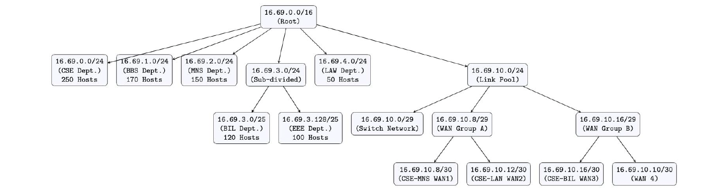

# Enterprise Campus Network Infrastructure & VLSM Routing Architecture

A complete multi-departmental campus network design and routing implementation. This project models an enterprise university topology with hierarchical Variable Length Subnet Masking (VLSM), multi-tier WAN backbones, dynamic RIPv2 routing, static fallback routes, centralized DHCP relaying, and DNS/Mail infrastructure.

---

## Architecture Overview

- **Root Address Space:** `16.69.0.0/16`
- **Departments Supported:** CSE, BBS, MNS, BIL, EEE, and LAW
- **Routing Protocols:** Hybrid deployment of **RIPv2** (dynamic backbone routing) and **Static Routing with Floating Backup Routes** (Administrative Distance 5)
- **Infrastructure Services:** Centralized DNS (`16.69.0.10`), departmental web/mail servers, DHCP pools with exclusion lists, and IP helper address relaying

---

## Hierarchical VLSM Subnet Allocation

Subnets were assigned using Variable Length Subnet Masking (VLSM) prioritizing host capacity to minimize unallocated IP address space:

| Department / Network | Required Hosts | Subnet Allocated | CIDR | Usable Range | Gateway |
| :--- | :--- | :--- | :--- | :--- | :--- |
| **CSE Department** | ~250 | `16.69.0.0` | `/24` | `16.69.0.1 - 16.69.0.254` | `16.69.0.1` |
| **BBS Department** | ~170 | `16.69.1.0` | `/24` | `16.69.1.1 - 16.69.1.254` | `16.69.1.1` |
| **MNS Department** | ~150 | `16.69.2.0` | `/24` | `16.69.2.1 - 16.69.2.254` | `16.69.2.1` |
| **BIL Department** | ~120 | `16.69.3.0` | `/25` | `16.69.3.1 - 16.69.3.126` | `16.69.3.1` |
| **EEE Department** | ~100 | `16.69.3.128` | `/25` | `16.69.3.129 - 16.69.3.254` | `16.69.3.129` |
| **LAW Department** | ~50 | `16.69.4.0` | `/26` | `16.69.4.1 - 16.69.4.62` | `16.69.4.1` |
| **Switch Backbone** | Infrastructure | `16.69.4.64` | `/29` | `16.69.4.65 - 16.69.4.70` | N/A |
| **WAN Serial Links** | Point-to-Point | `16.69.4.72+`| `/30` | 2 usable addresses per link | N/A |

---

## Core Network Features

### 1. Centralized Core & Routing Strategy
- **Core Router (`R-CSE`):** Acts as the central traffic broker between Gigabit Ethernet backbone segments and serial WAN point-to-point links.
- **Dynamic Routing:** RIPv2 (`network 16.0.0.0`, `no auto-summary`) dynamically propagates reachability across the high-speed switch backbone connecting CSE, BBS, and EEE.
- **Failover / Floating Routes:** Branch routers (e.g., `R-LAW`, `R-BIL`) maintain dual WAN connections with floating default routes (`distance 5`) for link redundancy.

### 2. Centralized DHCP Relay & Exclusions
- Centralized DHCP management hosted on the core router serves remote department subnets via `ip helper-address` forwarders.
- Critical IP spaces (servers and default gateways) are isolated via `ip dhcp excluded-address` configurations.

### 3. Dedicated Server Farm
- **DNS Server:** `16.69.0.10`
- **Department Web Servers:** CSE (`16.69.0.20`), MNS (`16.69.2.20`)
- **Department Mail Servers:** Dedicated mail host assigned per department.

---

## Cisco IOS Scripts & Deployment

Device configuration scripts are categorized in `/cisco_configs`:
- `R-CSE_core.cfg`: Core router interfaces, DHCP pools, static routes, and RIPv2.
- `R-EEE.cfg`: Gigabit backbone, LAN setup, and helper-address forwarding.
- `R-BBS.cfg`: Gigabit backbone and default gateway routing.
- `R-MNS.cfg`: Serial WAN connectivity and remote DHCP client relay.
- `R-LAW.cfg`: Serial WAN redundant links and local DHCP pool management.
- `R-BIL.cfg`: Point-to-point serial links and floating backup route failover.
